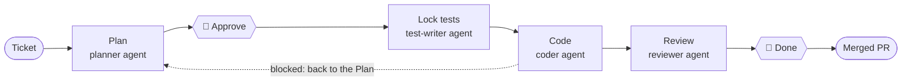

# Invar

[](https://github.com/webzards-org/invar/actions/workflows/ci.yml)

**Keep the specification fixed while an AI agent writes the code against it.**

Invar is a Claude Code plugin that turns AI-assisted coding into a disciplined
cycle: a person agrees what "done" means, a checksum freezes it, and the agent
that writes the code cannot move the target it is measured against.

> The name comes from the nickel–iron alloy that barely changes shape under
> heat or load, made for measuring instruments. The measuring rod does not
> stretch to fit the measurement.

```bash
claude plugin marketplace add webzards-org/invar#dist --scope project
claude plugin install invar@invar --scope project
```

Then ask Claude Code to run `invar init`. Full setup: [`docs/INSTALL.md`](docs/INSTALL.md).

---

## The problem

An AI coding agent under pressure (a long session, a half-understood ticket, a
test that will not pass) deforms the specification first. An acceptance
criterion is quietly relaxed until the code satisfies it, and the result still
looks correct. That is worse than a visible failure.

Prompts and skill packs try to _talk_ an agent out of this. Invar is
_structured_ so the agent cannot quietly do it.

## The idea

Invar is a method of work, not a skill set. Each part comes from a practice
that predates AI agents:

| Practice                        | In Invar                                                                                                                       |
| ------------------------------- | ------------------------------------------------------------------------------------------------------------------------------ |
| Specification by example (ATDD) | Numbered acceptance criteria in a Plan the developer approves                                                                  |
| Separation of duties            | The coder does not write the tests that judge it and cannot change its criteria; the reviewer works independently of the coder |
| Test-first, red before green    | A locked test must fail on an assertion before the code exists                                                                 |
| Design by contract              | Business invariants are explicit, named and checked in review                                                                  |
| Architecture decision records   | A decision log keeps _why_, after the ticket is gone                                                                           |
| Verification, not trust         | Every boundary is checked on disk and in CI, never left to an instruction                                                      |

**Invar recommends; the developer decides.** Approving a Plan, skipping tests,
unlocking a test, recording a decision and closing a cycle are the developer's
commands. The agent cannot run them.

## How a ticket flows

Each phase has its own definition of done. Its output is a finished product of
that phase; if it is not good enough, the work goes back to the phase before,
not forward with a patch. Every transition is guarded by a person's decision
or by a deterministic check, never by the agent's good will.



👤 a decision only the developer can make. Every other transition is guarded
by a deterministic check in the `invar` CLI. The full flow, with every command
and return path, is in [`docs/USAGE.md`](docs/USAGE.md).

**A ticket too large for one cycle is split before it is planned.** The
planner first works out what the ticket changes. If it holds several things
that could each be built and reviewed on their own, it writes no Plan and
answers `SPLIT` with the reason. You decide: ask it to propose the split, and
it lists the tasks in dependency order, each with a title and a description
ready to paste into your tracker; or tell it to plan the ticket as one. Invar
never creates tickets: how your team tracks work stays your choice. Smaller
cycles mean less for an agent to guess, and Plans and diffs small enough to
review properly.

Not every ticket needs the cycle. Typos, copy changes and dependency bumps
skip it, and the main session tells you so in one line.

## Separate agents, separate scopes

The main Claude Code session acts as a dispatcher: it talks to you and starts
four agents, each in its own context, each seeing only what its job needs.
Narrow, approved input means less to guess, less to hallucinate, and output
that stays relevant to the ticket.

| Agent           | Reads                                                                       | Writes                                | Never sees                                                       |
| --------------- | --------------------------------------------------------------------------- | ------------------------------------- | ---------------------------------------------------------------- |
| **planner**     | ticket, `AI_CONTEXT.md`, `BUSINESS_CONTEXT.md`, decision log, relevant code | the Plan (draft), or a proposed split | —                                                                |
| **test-writer** | approved Plan, `AI_CONTEXT.md`                                              | locked acceptance tests               | business context, decision log                                   |
| **coder**       | approved Plan, `AI_CONTEXT.md`, code in scope                               | the implementation                    | `BUSINESS_CONTEXT.md` (only what the Plan carries), decision log |
| **reviewer**    | Plan criteria, both context files, the diff                                 | an advisory report                    | the coder's transcript, decision log                             |

The coder answers in a fixed shape: `DONE`, `BLOCKED <reason>`, or
`BLOCKED-TEST <file> <AC> <reason>`. It can finish or stop. It cannot
renegotiate the specification halfway through.

## Context that makes the difference

Three sources give the agents what no model knows from training: how _your_
project is built, what _your_ business must never get wrong, and what _your_
team already learned.

### `AI_CONTEXT.md`: how the project is built

Your conventions: layers and boundaries, naming, module rules, and how tests
are written (framework, test database, what may be faked). Delivered
automatically to every session, the coder and the test-writer by hooks, so it
never depends on an agent remembering to load it.

### `BUSINESS_CONTEXT.md`: what must never break

Two sections:

- **Invariants**: rules no ticket may break, such as _every tenant-scoped
  query is filtered by account_.
- **Regional / parameterized facts**: values that differ per country, tenant
  or plan. When a ticket touches one, the planner **always** asks; the right
  answer is not in the code.

The planner carries every invariant the ticket touches into the Plan, with a
criterion that would fail if it were broken. The coder sees business rules
only as you approved them in the Plan, so it implements your version instead
of interpreting the whole rulebook. The reviewer then checks the branch
against **every** invariant, and reports one the Plan forgot under its own
heading.

### The decision log: memory that outlives the ticket

`.invar/decisions/` holds one file per entry, insert-only: `confirmed`,
`correction`, `failed`, `note`. The agent drafts an entry from what the cycle
actually did; you read it, edit it, and record it. The planner reads the log
on every later ticket, so a lesson learned once (including a failed attempt)
is not repeated months later. Six months on, _"why does it work this way?"_
has an answer in the repository.

Invar scaffolds both context files and never writes their content: these are
your team's decisions, not the tool's.

## The Plan: the whole ticket, in the branch

The Plan is a file, `.invar/plans/<TICKET>-<slug>/spec.md`, committed on the
branch next to the code. It holds what a diff never shows: the ticket, the
intent, the scope, the questions asked and their answers, the alternatives
rejected and why, the acceptance criteria, and the business rules and
conventions this ticket touches.

**Anyone can pick up the work.** A developer goes on holiday or is pulled onto
something urgent; a teammate checks out the branch and has everything: the
code so far and the full context of the ticket, as approved. No handover
meeting, no re-planning, no guessing what was agreed.

**Reviewers see the intent, not just the change.** While the PR is open, the
Plan is in it, so a human reviewer or an AI reviewer such as CodeRabbit reads
what the change is meant to do and what was deliberately left out. Fewer
review comments born of wrong assumptions, and a flawed specification is
caught in plain language rather than in code. `invar pr-body` also renders
the Plan as the PR description.

**No clutter left behind.** `/invar:done` deletes the Plan inside the same
PR, so it never piles up on `main`. What lasts is what is worth keeping: the
code, the locked tests, the PR description, and the decision log entry if you
recorded one.

## Built for the developer

- **One install.** The plugin carries the CLI binary, hooks, agents and
  skills. Teammates get it by opening the project in Claude Code.
- **You talk to Claude Code as usual.** The main session runs the cycle and
  tells you when it needs you. Your steps are a handful of slash commands:

  | Command                            | When                                                  |
  | ---------------------------------- | ----------------------------------------------------- |
  | `/invar:approve <TICKET>`          | You read the Plan and agree with it                   |
  | `/invar:relock <TICKET> <file>`    | The coder shows a locked test is wrong, and you agree |
  | `/invar:review <TICKET>`           | Optional, before the PR                               |
  | `/invar:log`, `/invar:log-approve` | Optional decision entry                               |
  | `/invar:done <TICKET>`             | The PR review is over                                 |

- **No copy-pasting output.** Hooks put check results into the agent's
  context in the same turn.
- **Your tooling stays yours.** Invar reads results from JUnit XML, which
  Pest, PHPUnit, pytest and Vitest all write; it never replaces your test
  runner or linters.
- **No surprises in a mixed team.** Checksums are computed on canonicalized
  text, so a CRLF checkout never invalidates an approval. `invar init` merges
  into your existing `.gitignore`, `.gitattributes` and
  `.claude/settings.json` without overwriting anything.
- **Works in CI with no agent.** `invar acceptance verify` checks every locked
  test on each push.

## Principles

1. **The CLI is the system; the plugin is a shell.** Every check and refusal
   is made by the `invar` binary (Rust, static).
2. **No LLM inside Invar.** Your own Claude Code session is the only runtime,
   so every verdict is deterministic and reproducible.
3. **Boundaries live on disk, not in prompts.** A rule checked against a
   file's digest is a boundary; a rule an agent is asked to follow is a
   convenience.
4. **The on-disk format is the contract.** Plan header, `invar.yaml`, decision
   entries and the lock line are versioned public formats in `contracts/`.
5. **Language-neutral core.** Nothing in the core parses PHP, Python or JS.

## Status

Invar is at **0.1.x** and under active development as a side project.

- Supported: Claude Code on Linux x86_64 and macOS (Apple silicon and Intel).
- Not yet: Windows, Linux arm64, other agent runtimes.
- Next on the roadmap: a recorded pilot on a real project, Gherkin-style
  acceptance tests, and language adapters. Plans are tracked in
  [GitHub issues](https://github.com/webzards-org/invar/issues).

Every release binary has a build provenance attestation you can check with
`gh attestation verify` ([how](docs/INSTALL.md#verifying-a-binary)).

## Documentation

- [`docs/INSTALL.md`](docs/INSTALL.md): installing for a team or yourself, acceptance tests, CI
- [`docs/USAGE.md`](docs/USAGE.md): one ticket, step by step
- [`docs/DESIGN.md`](docs/DESIGN.md): the design document and its reasoning

## Contributing

See [`CONTRIBUTING.md`](CONTRIBUTING.md). Commits need a DCO sign-off. Report
security issues privately as described in [`SECURITY.md`](SECURITY.md).

## License

Licensed under either of MIT or Apache-2.0, at your option.
