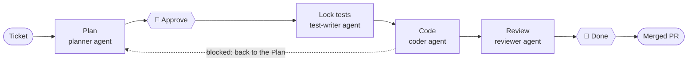

# Invar

[](https://github.com/webzards-org/invar/actions/workflows/ci.yml)

**Keep the specification fixed while an AI agent writes the code against it.**

Invar is a Claude Code plugin that turns AI-assisted coding into a disciplined
cycle: a person agrees what "done" means and approves it, a checksum freezes it,
and a change to that target after approval stops the work before it counts as
done.

> **Beta.** The on-disk formats are stable; prompts and commands may still
> change. [What that means](#status) ·
> [Tell us how it went](https://github.com/webzards-org/invar/issues/new?template=2-beta-feedback.yml)

> The name comes from the nickel–iron alloy that barely changes shape under
> heat or load, made for measuring instruments. The measuring rod does not
> stretch to fit the measurement.

```bash
claude plugin marketplace add webzards-org/invar#dist --scope project
claude plugin install invar@invar --scope project
```

Then ask Claude Code to run `invar init`. Full setup: [`docs/INSTALL.md`](docs/INSTALL.md).


*A full cycle on a real ticket, from the planner's questions to the review, in
under two minutes. Watch the end: the reviewer flags a business rule the Plan
never named.*

---

## The problem

An AI coding agent under pressure (a long session, a half-understood ticket, a
test that will not pass) deforms the specification first. An acceptance
criterion is quietly relaxed until the code satisfies it, and the result still
looks correct. That is worse than a visible failure.

Prompts and skill packs try to _talk_ an agent out of this. Invar is
_structured_ so the agent cannot quietly do it.

## The idea

Invar is a method of work, not a skill set. Each part comes from a practice
that predates AI agents:

| Practice                        | In Invar                                                                                                                       |
| ------------------------------- | ------------------------------------------------------------------------------------------------------------------------------ |
| Specification by example (ATDD) | Numbered acceptance criteria in a Plan the developer approves                                                                  |
| Separation of duties            | The coder does not write the tests that judge it, and a change to its criteria is detected; the reviewer works independently of the coder |
| Test-first, red before green    | A locked test must fail on an assertion before the code exists                                                                 |
| Design by contract              | Business invariants are explicit, named and checked in review                                                                  |
| Architecture decision records   | A decision log keeps _why_, after the ticket is gone                                                                           |
| Verification, not trust         | Every boundary is a check on disk by the `invar` CLI, never left to an instruction                                             |

**Invar recommends; the developer decides.** Approving a Plan, skipping tests,
unlocking a test, recording a decision and closing a cycle are the developer's
commands. The agent is refused when it tries to run them.

## What protects the work on your machine

The whole cycle runs where you work: in your Claude Code session, on your
machine, with no server and no CI. Four things keep the target fixed while an
agent writes the code:

- **The gate.** `/invar:approve` records a checksum of the Plan you read.
  `invar plan check` then refuses to start an agent on a Plan that changed by
  one character, and `/invar:done` refuses to close it. When the invariants in
  `BUSINESS_CONTEXT.md` have ids (`INV-1`), the gate lists every one the Plan
  does not name, so approving says out loud that it does not apply.
- **Locked tests.** The test-writer turns each criterion into a test that must
  fail before the code exists. `invar acceptance lock` then writes a digest,
  and the criteria the file covers (`ac=AC1,AC2`), into the file's lock line.
  A locked test that changes is refused by `plan check` and `done`, and
  `invar acceptance run` says per criterion whether the ticket's locked tests
  pass, before the coder answers `DONE` and again after.
- **The guard.** A hook on every `Write`, `Edit` and `Bash` call stops an agent
  editing an approved Plan or a locked test, writing approval values into a
  draft, weakening `invar.yaml`, removing the deny rule from
  `.claude/settings.json` or rewriting a Plan audit's baseline, and running the
  commands that are yours: approve, unlock, record, done.
- **The Plan audit, optional.** `/invar:plan-audit <TICKET>` has a second agent
  read the draft against the code before you approve. It corrects names and
  paths, each with the `file:line` it read, and reports a criterion that cannot
  pass or two that contradict. Invar computes the report; approving stays
  yours.

**What this guarantees, and where it stops.** These checks on disk catch an
accidental or incidental change: a criterion relaxed along the way, a test
edited until it passes, an approval value filled into a draft, a check turned
off in `invar.yaml` in passing. They do not stop an agent that deliberately
gets past them through its shell: anything that can run `invar` can compute a
new digest, checksum or audit baseline, and the plugin, its hooks and its
binary are files on the same machine. Invar makes an honest agent stop and a
careless change visible; it does not make a determined one powerless. The
[optional CI checks](#optional-ci-checks-early) repeat some of these checks
where the agent cannot change the answer.

## How a ticket flows

Each phase has its own definition of done. Its output is a finished product of
that phase; if it is not good enough, the work goes back to the phase before,
not forward with a patch. Every transition is guarded by a person's decision
or by a deterministic check, never by the agent's good will.



👤 a decision only the developer can make. Every other transition is guarded
by a deterministic check in the `invar` CLI. The full flow, with every command
and return path, is in [`docs/USAGE.md`](docs/USAGE.md).

**A ticket too large for one cycle is split before it is planned.** The
planner first works out what the ticket changes. If it holds several things
that could each be built and reviewed on their own, it writes no Plan and
answers `SPLIT` with the reason. You decide: ask it to propose the split, and
it lists the tasks in dependency order, each with a title and a description
ready to paste into your tracker; or tell it to plan the ticket as one. Invar
never creates tickets: how your team tracks work stays your choice. Smaller
cycles mean less for an agent to guess, and Plans and diffs small enough to
review properly.


*A real run: the planner splits a ticket in two, and the main session creates
the tickets in GitHub once the developer agrees.*

Not every ticket needs the cycle. Typos, copy changes and dependency bumps
skip it, and the main session tells you so in one line.

## Separate agents, separate scopes

The main Claude Code session acts as a dispatcher: it talks to you and starts
four agents, each in its own context, each seeing only what its job needs.
Narrow, approved input means less to guess, less to hallucinate, and output
that stays relevant to the ticket.

| Agent           | Reads                                                                       | Writes                                | Never sees                                                       |
| --------------- | --------------------------------------------------------------------------- | ------------------------------------- | ---------------------------------------------------------------- |
| **planner**     | ticket, `AI_CONTEXT.md`, `BUSINESS_CONTEXT.md`, decision log, relevant code | the Plan (draft), or a proposed split | —                                                                |
| **test-writer** | approved Plan, `AI_CONTEXT.md`                                              | locked acceptance tests               | business context, decision log                                   |
| **coder**       | approved Plan, `AI_CONTEXT.md`, code in scope                               | the implementation                    | `BUSINESS_CONTEXT.md` (only what the Plan carries), decision log |
| **reviewer**    | Plan criteria, both context files, the diff                                 | an advisory report                    | the coder's transcript, decision log                             |

The coder answers in a fixed shape: `DONE`, `BLOCKED <reason>`, or
`BLOCKED-TEST <file> <AC> <reason>`. It can finish or stop. It cannot
renegotiate the specification halfway through.

## Context that makes the difference

Three sources give the agents what no model knows from training: how _your_
project is built, what _your_ business must never get wrong, and what _your_
team already learned.

### `AI_CONTEXT.md`: how the project is built

Your conventions: layers and boundaries, naming, module rules, and how tests
are written (framework, test database, what may be faked). Delivered
automatically to every session, the coder and the test-writer by hooks, so it
never depends on an agent remembering to load it.

### `BUSINESS_CONTEXT.md`: what must never break

Three sections:

- **Terms**: the business's own words, one line each, such as _available
  balance_. The invariants use them, and the planner uses them in the Plan.
- **Invariants**: rules no ticket may break, such as _every tenant-scoped
  query is filtered by account_.
- **Regional / parameterized facts**: values that differ per country, tenant
  or plan. When a ticket touches one, the planner **always** asks; the right
  answer is not in the code.

The planner carries every invariant the ticket touches into the Plan, with a
criterion that would fail if it were broken. The coder sees business rules
only as you approved them in the Plan, so it implements your version instead
of interpreting the whole rulebook. The reviewer then checks the branch
against **every** invariant, and reports one the Plan forgot under its own
heading.

### The decision log: memory that outlives the ticket

`.invar/decisions/` holds one file per entry, insert-only: `confirmed`,
`correction`, `failed`, `note`. The agent drafts an entry from what the cycle
actually did; you read it, edit it, and record it. The planner reads the log
on every later ticket, so a lesson learned once (including a failed attempt)
is not repeated months later. Six months on, _"why does it work this way?"_
has an answer in the repository.

Invar scaffolds both context files and never writes their content: these are
your team's decisions, not the tool's.

## The Plan: the whole ticket, in the branch

The Plan is a file, `.invar/plans/<TICKET>-<slug>/spec.md`, committed on the
branch next to the code. It holds what a diff never shows: the ticket, the
intent, the scope, the questions asked and their answers, the alternatives
rejected and why, the acceptance criteria, and the business rules and
conventions this ticket touches.

**Anyone can pick up the work.** A developer goes on holiday or is pulled onto
something urgent; a teammate checks out the branch and has everything: the
code so far and the full context of the ticket, as approved. No handover
meeting, no re-planning, no guessing what was agreed.

**Reviewers see the intent, not just the change.** While the PR is open, the
Plan is in it, so a human reviewer or an AI reviewer such as CodeRabbit reads
what the change is meant to do and what was deliberately left out. Fewer
review comments born of wrong assumptions, and a flawed specification is
caught in plain language rather than in code. `invar pr-body` also renders
the Plan as the PR description.

**No clutter left behind.** `/invar:done` deletes the Plan inside the same
PR, so it never piles up on `main`. What lasts is what is worth keeping: the
code, the locked tests, the PR description, and the decision log entry if you
recorded one.

## Built for the developer

- **One install.** The plugin carries the CLI binary, hooks, agents and
  skills. Teammates get it by opening the project in Claude Code.
- **You talk to Claude Code as usual.** The main session runs the cycle and
  tells you when it needs you. Your steps are a handful of slash commands:

  | Command                            | When                                                  |
  | ---------------------------------- | ----------------------------------------------------- |
  | `/invar:plan-audit <TICKET>`       | Optional, before you approve                          |
  | `/invar:approve <TICKET>`          | You read the Plan and agree with it                   |
  | `/invar:relock <TICKET> <file>`    | The coder shows a locked test is wrong, and you agree |
  | `/invar:review <TICKET>`           | Optional, before the PR                               |
  | `/invar:log`, `/invar:log-approve` | Optional decision entry                               |
  | `/invar:done <TICKET>`             | The PR review is over                                 |

- **No copy-pasting output.** Hooks put check results into the agent's
  context in the same turn.
- **Your tooling stays yours.** Invar reads results from JUnit XML, which
  Pest, PHPUnit, pytest and Vitest all write; it never replaces your test
  runner or linters.
- **No surprises in a mixed team.** Checksums are computed on canonicalized
  text, so a CRLF checkout never invalidates an approval. `invar init` merges
  into your existing `.gitignore`, `.gitattributes` and
  `.claude/settings.json` without overwriting anything.

## Optional: CI checks (early)

The cycle needs no CI. For a team that wants some checks repeated where an
agent cannot change the answer, four commands run in CI, with no agent, on the
attested release binary, against the pull request's base:

| Command                                          | What it adds                                                                                                        |
| ------------------------------------------------ | ------------------------------------------------------------------------------------------------------------------- |
| `invar acceptance verify [--results junit.xml]`  | Every lock is unchanged; with `--results`, every locked test passed in your own test run, each listed criterion too |
| `invar config check --base <ref>`                | The branch does not weaken a check in `invar.yaml`, unless you said why in an `Invar-Config:` trailer               |
| `invar cycle check --base <ref>`                 | Changes to the paths in `cycle.required_paths` went through a closed cycle, or you skipped it in an `Invar-Skip:` trailer |
| `invar approval verify --base <ref>`             | With `approval.signed`, every approval on the branch is signed by a key in the base's `.invar/approvers`            |

They exist and are tested, and may still change: running the cycle in CI/CD is
a later phase. Setting them up, with `fetch-depth: 0`, `--base` and protection
for the workflow file, is in
[`docs/INSTALL.md`](docs/INSTALL.md#optional-ci-checks-early).

**Signed approvals.** With `approval.signed: true`, `/invar:approve` signs the
approval with your SSH signing key, and `/invar:skip` and
`/invar:config-accept` sign a skipped cycle and a weakened check. What that
guarantees, and what it does not: with `approval.signed: true` on the base
branch, and `invar approval verify`, `invar cycle check` and `invar config
check` run in CI on the attested release binary, a pull request passes only
when every approval of a Plan on it, every skip of the cycle and every weakened
check was signed by a key the base branch's `.invar/approvers` lists, over
exactly what it covers, and when no approval was put back from earlier on the
branch or from any branch git still reaches. Who signed is the record, not
`Approved-by`. What it does not guarantee is that a person meant it: a
signature shows that the key was used. A key the agent can use without you, a
file with no passphrase or a key unlocked in `ssh-agent`, signs for the agent
too, and then a signature proves no more than the checksum. A key that asks on
each use, a security key's touch or a confirmation, can still be made to ask by
the agent, and the prompt does not say what is being signed. On your machine
the checks stay what they are above; a signature adds something only where CI
checks it ([`docs/INSTALL.md`](docs/INSTALL.md#signed-approvals),
`contracts/formats/approval-signature.md` §7).

## Principles

1. **The CLI is the system; the plugin is a shell.** Every check and refusal
   is made by the `invar` binary (Rust, static).
2. **No LLM inside Invar.** Your own Claude Code session is the only runtime,
   so every verdict is deterministic and reproducible.
3. **Boundaries live on disk, not in prompts.** A rule checked against a
   file's digest is a boundary; a rule an agent is asked to follow is a
   convenience.
4. **The on-disk format is the contract.** Plan header, `invar.yaml`, decision
   entries and the lock line are versioned public formats in `contracts/`.
5. **Language-neutral core.** Nothing in the core parses PHP, Python or JS.

## Status

Invar is at **0.3.0**, in beta, and under active development as a side
project. Tell us how it went on your project with the
[Beta feedback](https://github.com/webzards-org/invar/issues/new?template=2-beta-feedback.yml)
form.

**What is stable.** The on-disk formats: the Plan header, `invar.yaml`,
decision entries and the lock line. Each is specified in `contracts/` with its
own version and history. Changes follow one rule: an absent key means the
previous behavior, so a Plan or a lock written by an earlier version keeps its
meaning.

**What may still change.** Everything around the formats: the agents' prompts
and the questions they ask, slash commands and their flags, CLI commands and
the wording of their output. Every change is listed in
[`CHANGELOG.md`](CHANGELOG.md).

**Known limitations.**

- Claude Code only. Other agent runtimes are not supported.
- Linux x86_64 and macOS (Apple silicon and Intel). Not yet Windows or
  Linux arm64.
- Locked acceptance tests need a test setup that already works on its own:
  the test-writer writes tests, it does not set up your test environment
  ([`docs/INSTALL.md`](docs/INSTALL.md#acceptance-tests)). Without one, approve
  tickets with `--no-acceptance`.
- On disk, the approval is a checksum and a lock is a digest. They catch a
  careless or accidental change, not an agent with a shell that sets out to
  write its own
  ([what that means](#what-protects-the-work-on-your-machine)). What signed
  approvals add, and what they do not, is under
  [Optional: CI checks](#optional-ci-checks-early).
- `AI_CONTEXT.md` and `BUSINESS_CONTEXT.md`, together and with the labels
  Invar adds, must stay under the binding limit: 9,000 characters by default,
  at most 10,000. Above it,
  Invar refuses rather than let the context quietly stop reaching the agent.

Already using another skill set? See
[Using Invar with other skill sets](docs/USAGE.md#using-invar-with-other-skill-sets).

Next on the roadmap: a recorded pilot on a real project, Gherkin-style
acceptance tests, and language adapters. Plans are tracked in
[GitHub issues](https://github.com/webzards-org/invar/issues).

Every release binary has a build provenance attestation you can check with
`gh attestation verify` ([how](docs/INSTALL.md#verifying-a-binary)).

## Documentation

- [`docs/INSTALL.md`](docs/INSTALL.md): installing for a team or yourself, acceptance tests, the optional CI checks
- [`docs/USAGE.md`](docs/USAGE.md): one ticket, step by step
- [`docs/DESIGN.md`](docs/DESIGN.md): the design document and its reasoning

## Contributing

See [`CONTRIBUTING.md`](CONTRIBUTING.md). Commits need a DCO sign-off. Report
security issues privately as described in [`SECURITY.md`](SECURITY.md).

## License

Licensed under either of MIT or Apache-2.0, at your option.
