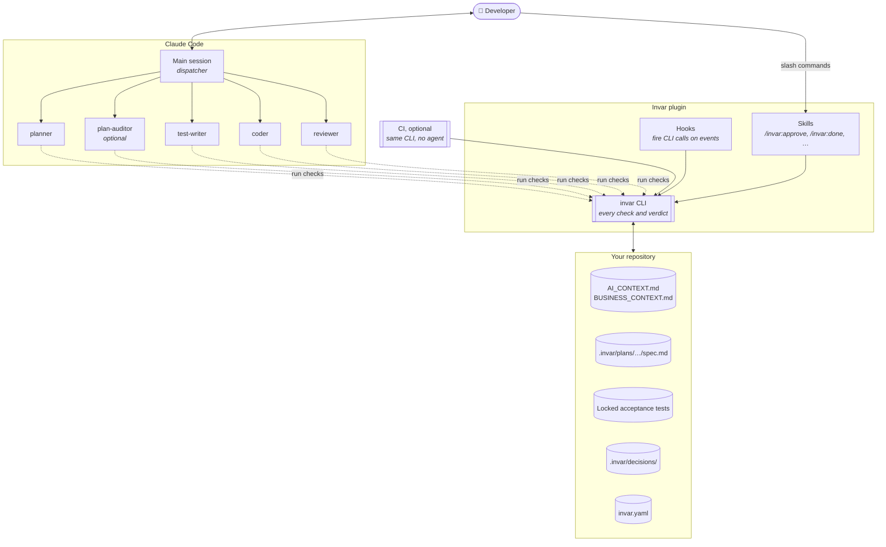
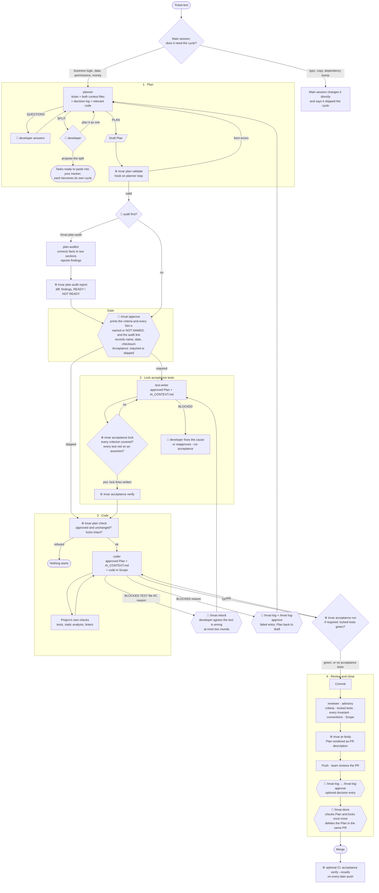
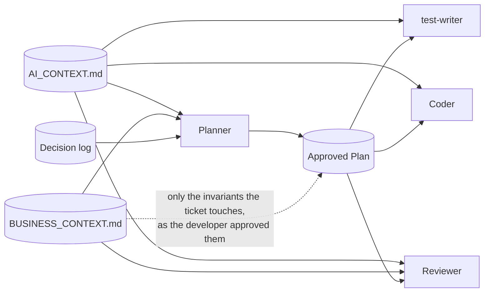
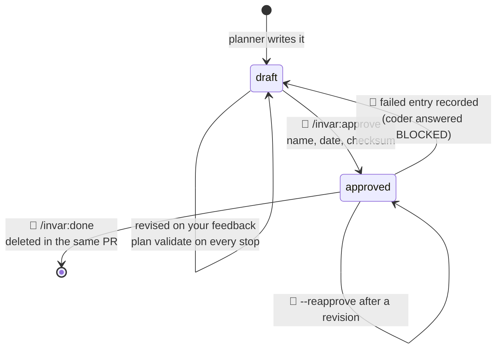

# How Invar works

This document explains what Invar is made of, how a ticket moves through it,
and why it is built the way it is. It describes what is built in 0.3.0. Invar
is used on the developer's machine, in their Claude Code session; the checks
that can also run in CI are an optional, early part (§12).
For installing, see [`INSTALL.md`](INSTALL.md); for the step-by-step cycle,
[`USAGE.md`](USAGE.md).

> **Section references.** Code, contracts and older notes cite sections of the
> previous design document (§4d, §13a, …). That revision, v3.1, is kept in the
> repository's history:
> [`docs/DESIGN.md` at c29122d](https://github.com/webzards-org/invar/blob/c29122d/docs/DESIGN.md).
> Where it disagrees with the code or a contract, the code and the contract win.

---

## 1. Why Invar exists

An AI coding agent is fast and capable, and it works under pressure: a long
session, a half-understood ticket, a test that will not pass. Under pressure
something gives, and what gives first is the specification. An acceptance
criterion is quietly relaxed until the code satisfies it. The result still
looks correct, which is worse than a visible failure.

The usual answer is a better prompt: instructions, skills, rules files that ask
the agent to behave. Invar takes the other route. It is **structured so the
agent cannot quietly do the wrong thing**, and every rule that matters is
checked on disk by a deterministic tool, not left to the agent's good will.

The name comes from the nickel–iron alloy that barely changes shape under heat
or load, made for measuring rods and reference standards: instruments whose
reading is only worth something if the instrument has not moved. Invar holds
the specification fixed while the code is written against it.

## 2. A method, not a skill set

Every part of Invar comes from a practice that long predates AI agents. The
agents are replaceable; the method is what lasts.

| Practice | What it means in Invar |
|---|---|
| **Specification by example** (ATDD) | "Done" is agreed before work starts, as numbered acceptance criteria in a Plan the developer approves |
| **Separation of duties** | The agent that writes the code does not write the tests that judge it, and cannot change the criteria it is measured against. The reviewer works independently of the coder |
| **Test-first, red before green** | A locked test must fail on an assertion before the code exists |
| **Design by contract** | Rules the application must never break are explicit, named and checked in review |
| **Small batches** | A ticket too large for one cycle is split before it is planned |
| **A human decides where it matters** | Approving, skipping tests, unlocking a test, recording a decision and closing a cycle are the developer's commands. Where a team runs the optional CI checks, skipping the cycle on a required path or weakening a check is a commit trailer the developer writes, or signs |
| **Architecture decision records** | A decision log keeps *why* after the ticket is gone |
| **Verification, not trust** | Every boundary is a check on disk by the CLI; CI can repeat it with its own binary |

**Invar recommends; the developer decides.** Where practice differs between
teams (how tickets are split and tracked, whether a ticket gets acceptance
tests, which cycles deserve a decision entry), Invar proposes and the team
chooses. It never imposes a process the team has not picked. A proposed split,
for one, names the strategy it used (by layer, or vertical slices that each
deliver a usable behavior) and offers the other when both fit the ticket.

## 3. The system at a glance



Four kinds of parts, each with one job:

- **The developer** makes the decisions: approve, unlock, record, close.
- **Agents** do the work, each in its own context with a narrow view (§5).
- **The `invar` CLI** renders every verdict. It is a static Rust binary that
  reads and writes plain files and never calls a model.
- **Files in your repository** are the state: the Plan, the locks, the
  decision log, the context. Because the state is on disk, the same checks
  can also run in CI, where no agent exists (§12).

## 4. The cycle in detail



👤 a step only the developer can take · ⚙ a deterministic check by the CLI

What each phase hands to the next is a finished product of that phase. When it
is not good enough, the work returns to the phase that produced it: a wrong
Plan goes back to the planner, a wrong test to the test-writer. Nothing is
patched downstream.

## 5. Agents with separate scopes

The main Claude Code session is a **dispatcher**. It talks to the developer,
starts the agents, relays questions, waits at the gate and offers the next
step. It renders no verdict, and apart from the trivial changes that skip the
cycle, it writes no code.

Each agent runs in its own context and sees only what its job needs. A narrow,
approved input leaves less to guess, which means fewer hallucinated APIs, less
drift from the ticket, and output that can be reviewed against one document.

| Agent | Default model | Reads | Produces | Answers |
|---|---|---|---|---|
| **planner** | opus | ticket, `AI_CONTEXT.md`, `BUSINESS_CONTEXT.md`, decision log, the code the ticket touches | a draft Plan, or a proposed split | `QUESTIONS`, `SPLIT`, or the Plan's path |
| **plan-auditor** | fable | the draft Plan, both context files, the code; never the planner's session or the log | corrections in two sections of the draft, and findings | findings in a fixed shape; Invar writes the report |
| **test-writer** | opus | approved Plan, `AI_CONTEXT.md` | one outside-in test per criterion, locked | `LOCKED` or `BLOCKED` |
| **coder** | sonnet | approved Plan, `AI_CONTEXT.md`, the code in Scope | the implementation | `DONE`, `BLOCKED`, `BLOCKED-TEST` |
| **reviewer** | opus | Plan criteria, both context files, the branch diff | an advisory report | a report in a fixed shape |

The defaults follow risk. The planner and the reviewer get a strong model
because a weak Plan weakens the gate itself and the reviewer is the safety net
for a missed invariant. The plan-auditor, which only runs when you ask, runs on
a different model from the planner, so the two are less likely to miss the
same things. The coder may run on a cheaper model because
everything it produces is checked on disk. The main session can choose
another model per call, and tells you before the gate when the planner ran on
anything other than its default. **No verdict depends on which model ran.**

Answers have a fixed shape on purpose. A coder can finish or stop; it cannot
renegotiate the specification halfway through a conversation that nobody
re-approves.

### Who sees what



The coder never reads `BUSINESS_CONTEXT.md` or the decision log. It meets
business rules only as the Plan states them. This is deliberate: a coder that
reads the whole rulebook starts weighing rules the ticket does not touch and
interpreting the ones it does. Instead it follows the version the developer
approved. The cost is stated plainly: an invariant the planner fails to carry
into the Plan is invisible to the coder. That is why the reviewer checks the
branch against **every** invariant and reports one the Plan missed under its
own heading. The coder does read `AI_CONTEXT.md`, and the reviewer checks,
independently, that the branch keeps the conventions the file states. A broken
one is reported with its words quoted, under a heading of its own after the
invariants. Style the file does not state stays out of the report.

## 6. Context: what no model knows from training

Three sources give the agents knowledge that exists only in your team. Invar
scaffolds the files and never writes their content: these are your decisions,
not the tool's.

### `AI_CONTEXT.md`: how the project is built

Layers and boundaries, naming, module rules, and above all **how tests are
written**: the framework, the test database, which fixtures or factories
exist, what may be faked and what never is. Every one of these is a project
decision with no safe default, and an agent that guesses wrong produces tests
that fail for reasons unrelated to the behavior.

It holds the project's own decisions, never generic framework advice: general
advice is already in every model's training data, and repeating it only makes
the file look finished while the rules that matter stay unwritten.

### `BUSINESS_CONTEXT.md`: what must never break

- **Terms**: the business's own words, one line each, which the invariants
  then use. *Available balance: what a customer can spend now, after holds.*
  A shared vocabulary (the ubiquitous language of domain-driven design) keeps
  the planner from naming the same thing differently from ticket to ticket,
  and an invariant from being read with another meaning. It is guidance, not
  a check: Invar scaffolds the heading, and the team decides whether to use it.
- **Invariants**: rules no ticket may break. *Every tenant-scoped query is
  filtered by account. Every state change by an operator notifies an admin.*
  Each may start with an id, `- INV-1: …` (below).
- **Regional / parameterized facts**: values that differ by country, tenant
  or plan: a payment provider, a billing cutoff, a time zone. When a ticket
  touches one, the planner **always asks**, because the right answer is not in
  the code.

A business *fact* belongs here. The technical convention derived from it
(store timestamps in UTC, convert at display) belongs in `AI_CONTEXT.md`.

**Invariant ids.** An id is `INV-` and a number, like an ADR number: never
reused, and left unused when its rule is removed, since a Plan or a PR may cite
it. With ids, a Plan names an invariant in its Implementation context as
`- BUSINESS_CONTEXT INV-2: …`, and a criterion that covers it cites it,
`- AC3 (INV-2): Given …`. `plan validate` refuses an id the file does not
define, a named invariant no criterion cites, and a criterion citing one the
Plan does not name. The ids are all or none: a file where only some invariants
have one is an error. Without ids everything works as before, with one warning
at the gate. What the ids buy is at the gate (§7): the developer sees which
invariants the Plan leaves out, instead of having to remember them.

### How context is delivered

| Who | What | How |
|---|---|---|
| Main session | both context files | `SessionStart` hook: `invar context show --binding` |
| planner | everything, including the decision log | `invar context show`, required by its prompt |
| coder, test-writer | `AI_CONTEXT.md` only | `SubagentStart` hook: `invar context show --conventions` |
| reviewer | Plan, both context files, the diff | `invar review-input` |

Binding context is **pushed by hooks**, so it arrives in every session without
an agent deciding to load it. Claude Code silently moves hook output above
10,000 characters into a file nobody is asked to read, so Invar enforces a
limit (`context.binding_limit`, 9,000 characters by default) and **refuses**
rather than letting context quietly stop arriving. Keep both files short.

An empty file with only the headings `invar init` wrote behaves exactly like
an absent one: Invar never switches on behavior you did not ask for.

## 7. The Plan

The Plan is where the ticket becomes a specification. The planner writes it;
the developer approves it; the coder is held to it.

```
.invar/plans/SHOP-214-cancel-unpaid-order/spec.md
```

A header the CLI owns, then fixed sections:

| Section | Why it is there |
|---|---|
| **Ticket** | The text as written, so intent can be traced |
| **Intent** | What the change is meant to achieve, in the developer's terms |
| **Scope** | What is touched and what is explicitly out of scope |
| **Open questions / answers** | What was asked and answered. Not inferable from the diff |
| **Rejected alternatives** | What was considered and dropped, and why. Not inferable either |
| **Acceptance criteria** | `AC1`, `AC2`, … in Given / When / Then. What the code is judged against |
| **Implementation context** | The few conventions, invariants and API notes *this* ticket needs, each labelled with its source |
| Acceptance tests to change | Optional: another ticket's locked test this one deletes, with a reason |

`Implementation context` is a **distillate, not a copy**. A Plan that pastes
the context files in becomes too long to be genuinely read at the gate, and a
gate nobody reads turns into a click.

### Lifecycle



**At the gate.** `/invar:approve` prints the criteria once more. When the
invariants have ids, it lists every one of them after the criteria, named in
the Plan (with the criteria that cite it) or `NOT NAMED`, so approving says
that the unnamed ones do not apply to this ticket. Then one line about the Plan
audit, if there was one. None of it refuses anything: it puts what the approval
means in front of the person who gives it.

**Frozen by a checksum.** `invar plan approve` records who approved, when, and
a SHA-256 digest of the Plan's body. From then on `plan check`, the coder's
first step and `done` all refuse a Plan that changed by a single character.
Text is canonicalized before hashing (UTF-8, BOM, line endings, trailing
whitespace), so a Windows checkout with `core.autocrlf` never invalidates an
approval.

### The Plan audit, optional

A Plan can be well-formed and still wrong: a column that does not exist, a path
with a typo, a criterion that cannot pass. `plan validate` checks the form, not
the facts. `/invar:plan-audit <TICKET>`, run by the developer before approval,
has the plan-auditor read the draft against the code. It may change two
sections only, and only facts with one right answer in the code, each with the
`file:line` it read: names in *Implementation context* (including a wrong
`INV-<n>`) and paths in *Scope*. Everything else is a finding, from a closed list
of kinds: a criterion that cannot pass, criteria that contradict, a ticket
sentence no criterion covers, an invariant the ticket touches that the Plan
does not name.

The agent never writes the report. `invar plan audit begin` records the Plan as
a baseline, and `invar plan audit report` computes the report from the
baseline, the findings and the Plan: each change as a diff with its reason,
`plan validate`, the findings, and `READY` or `NOT READY — <n> blocking
finding(s)`. An audit that changed any other section, or the header, gets no
report. The gate's line is computed the same way, so it says when the Plan
changed after the audit. `begin` is the developer's command, and the guard keeps
the agents' edit tools off the baseline and the report, because a baseline
taken again after an edit would hide that edit. `READY` is an agent's
assessment, not a check: it blocks nothing, and approving stays a person's
decision (`contracts/formats/plan-audit.md`).

**In git, not in a temp folder.** The Plan is committed on the branch next to
the code, which gives three things:

- **Handover.** A developer goes on holiday; a teammate checks out the branch
  and has the code so far and the whole agreed context of the ticket. No
  handover meeting, no re-planning.
- **Better review.** While the PR is open, a human reviewer or an AI reviewer
  such as CodeRabbit reads the intent, the scope and what was deliberately
  left out, not only the change.
- **Survives branch switches.** The reasoning comes back with the branch.

**Deleted when it has done its job.** A Plan is a consumable instruction, not
documentation. `/invar:done` deletes it inside the same PR, so `main` never
accumulates old Plans. Because a file added and deleted in one PR does not
appear in its net diff, `invar pr-body` renders the Plan into the PR
description first; that is where it stays readable after the merge.

## 8. Locked acceptance tests

With acceptance tests on, the agent that implements a ticket is not the agent
that decides whether it works.

1. The **test-writer** turns each criterion into a test that reaches the
   behavior from outside, as a user or client would: for a Laravel project, a
   Pest or PHPUnit feature test over HTTP against a real database. Each test
   names its criterion.
2. **`invar acceptance lock`** runs them and locks the files only if every
   criterion has a test and **every test fails on an assertion**. A test that
   already passes checks nothing; a test that crashes on a missing class is
   not red for the right reason.
3. Locking writes one line into each file:

   ```php
   // invar-lock: SHOP-214 sha256:9c1e4f… ac=AC1,AC2
   ```

   No manifest, no side files. The lock travels with the test, and so does
   the list of criteria it covers, under the same digest.
4. The **coder** makes them pass and may not touch them. `plan check` and
   `done` notice a changed locked file, and so does `acceptance verify` where
   CI runs it.

**When the test is wrong, a person decides.** The coder can show that a test
asserts something its criterion does not say (`BLOCKED-TEST`). It changes
nothing; you decide. `/invar:relock` unlocks that file, the test-writer fixes
and relocks it, and the coder starts again. At most two rounds per ticket: two
corrections of the same tests mean the criteria are not what you meant, and
the cycle should end as `failed`.

**Language-neutral by reading JUnit XML.** Invar runs the one command you
configure in `invar.yaml` and reads its JUnit report, which Pest, PHPUnit,
pytest and Vitest all write. It never parses your test code and never
replaces your runner.

**Every criterion the file covers, and green.** A lock proves a test did not
change, not that it passes. The `ac=` list says which criteria the file's
tests covered when it was locked, and the digest covers the list, so taking a
criterion off the line is a change like any other. A JUnit report is checked
against it: every locked file must have run, with a test of each criterion its
line lists, and every one of its tests must have passed; a skipped test, or one
that passed only on a retry, is not accepted. `invar acceptance run` runs the
ticket's locked tests after the coder's `DONE`, so that a review is not spent
on red tests, and `invar done --results <report>` makes the same check before
it closes the cycle. A file locked before the list existed keeps its digest and
the weaker check (some test of it ran, and every one that ran passed) until it
is locked again, with a note each time.

**After the merge, the locks keep working.** A lock needs no Plan, so `plan
check` and `done` keep checking every locked file on every later ticket. `invar
acceptance verify` needs no git history either, so a team that runs it in CI,
with `--results` on its own test report, checks them on every push.

Acceptance tests are decided per ticket at approval (`--acceptance` /
`--no-acceptance`, with a project default in `invar.yaml`), because not every
ticket justifies them, and that choice belongs to the team.

## 9. The decision log

Code shows *what* was built. The decision log keeps *why*.

```
.invar/decisions/
  2026-08-14-093012-orders-cancel-unpaid-order.md
```

- **One file per entry, insert-only.** Two branches never conflict over it,
  and nothing in Invar ever edits or deletes an entry.
- **Four types**: `confirmed` (what a finished cycle decided), `correction`
  (fixed by hand outside the cycle), `failed` (an attempt that did not work
  and why), `note`.
- **The agent drafts, the developer records.** `/invar:log` drafts an entry
  from what the cycle actually did, next to the Plan. You read it, edit it,
  and record it with `/invar:log-approve`. `done` refuses while an unrecorded
  draft is still there, so a reviewed entry is never lost with the Plan.
- **The planner reads it**, newest first, within a budget, on every later
  ticket. A lesson learned once, including a failed attempt, is not repeated
  months later.
- **Advisory, never binding.** No agent may fail or block on the log. The
  planner may depart from a past decision when you ask; it says so.
- **Kept away from the coder.** `invar init` adds a deny rule for reading
  `.invar/decisions/` to the project's Claude Code settings, and no hook
  pushes it into any context but the planner's.

A `failed` entry is often worth more than a successful one: "the Plan required
X; impossible because Y" is exactly what the next planner needs to know.
Recording one returns the Plan to draft.

A rule that keeps showing up in the log does not belong there: it is a
business fact for `BUSINESS_CONTEXT.md` or a convention for `AI_CONTEXT.md`.

## 10. The plugin: a thin shell over the CLI

What you install is a Claude Code plugin. It carries:

| Part | What it does |
|---|---|
| `invar` binary | Static builds for Linux x86_64 and macOS, picked by a small launcher |
| Hooks | Each one a single CLI call (table below) |
| Agents | planner, plan-auditor, test-writer, coder, reviewer |
| Protocol skill | The cycle as the main session runs it: when to use or skip it, dispatching, the gate, closing |
| Developer skills | `/invar:plan-audit`, `/invar:approve`, `/invar:relock`, `/invar:review`, `/invar:log`, `/invar:log-approve`, `/invar:done`; for the optional CI checks, `/invar:skip` and `/invar:config-accept` |

| Event | CLI call | Purpose |
|---|---|---|
| `SessionStart` | `context show --binding` | Both context files in every session |
| `SubagentStart` (coder, test-writer) | `context show --conventions` | `AI_CONTEXT.md` only |
| `SubagentStop` (planner) | `plan validate --all-drafts` | The planner sees what to fix in its Plan |
| `PreToolUse` (`Write`, `Edit`, `Bash`) | `plan guard` | Denies edits to an approved Plan, a locked test, approval values in a draft, a weakening of `invar.yaml`, the deny rule in `.claude/settings.json` and a Plan audit's baseline and report, and denies the agent the developer's commands |

**No logic in the plugin.** Hooks fire a command and pass its output back;
prompts and skills contain no branching on configuration. Anything that
decides is a CLI command, which is why the CLI behaves identically from a
hook, a terminal or CI, and why the checks can run in CI with no agent at
all. Tests in `core/` fail if a script with logic, a binary or a hook
that runs a developer-only command appears in the plugin.

**The developer's commands run before the model sees them.** A skill such as
`/invar:approve` runs its one CLI call itself, and the model cannot invoke the
skill. The guard also denies the agent running `plan approve`,
`decision approve`, `decision record`, `done`, `acceptance unlock`, `plan audit
begin`, `cycle skip` or `config accept` through the shell, and tells it to hand
the step to you instead.

## 11. What is guaranteed, and how strongly

Invar is honest about the strength of each mechanism, because a boundary you
overestimate is worse than one you know the limits of.

**On the developer's machine**, where the cycle runs:

| Mechanism | Strength | What it means |
|---|---|---|
| Plan checksum, lock digests and their `ac=` lists (`plan check`, `done`) | **Boundary** against accidents | A changed Plan or locked test is refused before an agent starts and before the cycle closes, whatever tool changed it |
| Red-before-green at lock time | **Boundary** | A test that cannot fail is never locked |
| Locked tests green (`done --results`) | **Boundary** against accidents | A locked test that did not run, failed, was skipped or passed only on a retry is refused, from the team's own report |
| Invariants at the gate (`INV-<n>`) | Visibility | The developer sees every invariant the Plan leaves out before approving. It refuses nothing |
| `acceptance run` after `DONE` | Convenience | Stops the main session offering a review of red tests |
| `plan guard` hook | Convenience | Saves the agent a wasted edit, and makes it hand the developer's commands back. It sees only the edit tools and reads command lines, not a shell, so a script gets past it; the checksum and the digests still catch the result |
| Plan audit | Advisory | An agent's assessment of the draft, with a report the CLI computes. It never refuses an approval |
| Separate agent contexts | Focus | Keeps each agent's view narrow. A determined agent could still read a file; nothing that reads it can change a verdict |
| Deny rule on the decision log | Focus | Stops accidental reads. The log is advisory, so a leak costs focus, never correctness |
| Review | Advisory | An LLM judgement with false positives and misses. Information for the developer, never a gate |

**The local guarantee, and its limit.** Checks on disk catch an accidental or
incidental change: a criterion relaxed along the way, a test edited until it
passes, an approval value written into a draft, a check switched off in
`invar.yaml` in passing. They do not stop an agent that deliberately rewrites a
digest, a checksum, an audit baseline or the plugin through its shell: anything
that can run `invar` can compute a digest, and the plugin's binary, its hooks
and `.claude/settings.json` are files on the same machine. What Invar
guarantees there is that the ordinary failure, an agent changing what was
approved and carrying on, is **mechanically visible** rather than invisible,
and that an approval made by the wrong party leaves exactly the evidence the
checks look at. The optional CI checks (§12) move some of these checks to where
the agent cannot reach.

The rule that keeps this table honest: **no boundary moves out of an on-disk
check into a hook or a prompt.**

## 12. The optional CI part

These commands exist for teams that want the checks repeated where an agent
cannot change the answer. They are early: running the cycle in CI/CD is a
later phase. Each runs on CI's own binary, the release checked with `gh
attestation verify`, against the pull request's target given as `--base`
(never `git.base_branch`, which the branch could point at itself), and those
that read history need `fetch-depth: 0`.

| Command | What it checks | Who may let it through |
|---|---|---|
| `acceptance verify [--results <report>]` | Every lock unchanged; with `--results`, every locked test ran, each listed criterion too, and passed | Nobody: the developer relocks or fixes |
| `config check` | `invar.yaml` on the branch does not weaken a check against the base: a closed list of keys (`invar-yaml.md` §3.9), from the `acceptance:` section removed to a value added to `acceptance.fakes_allowed` | The developer, with an `Invar-Config: <reason>` trailer |
| `cycle check` | Changes to the paths in `cycle.required_paths`, read from the base, were made while a cycle closed on the branch had its Plan approved | The developer, with an `Invar-Skip: <reason>` trailer |
| `approval verify` | With `approval.signed: true` on the base, every approval on the branch is signed by a key in the base's `.invar/approvers`, matches its Plan, and was not replayed from history | Nobody: the developer approves again |

**Signed approvals.** With `approval.signed: true`, `plan approve` signs the
approval with the developer's SSH signing key, over the ticket, the checksum
and an `Approval-id` new on every approval, and writes `approval.sig` next to
the Plan. With it on at the base, the two trailers count only when signed too
(`/invar:skip`, `/invar:config-accept`). The approvers list and the switch are
read from the base, so a branch cannot add its own approver or turn the check
off for itself. A signature shows that a key was used, not that a person meant
it: a key the agent can use without the developer signs for the agent too, and
proves no more than the checksum (`contracts/formats/approval-signature.md`
§7).

**What CI still needs from the team.** A pull request can edit the workflow on
its own branch. The steps have to be required status checks on the base, and
`.github/workflows/` and `.invar/approvers` owned in `CODEOWNERS`, or a branch
can drop the check that would refuse it ([`INSTALL.md`](INSTALL.md#protect-the-workflow)).

## 13. Principles behind the architecture

- **The CLI is the system; the plugin is a shell.** The CLI holds every
  decision; plugin APIs can change without touching a single verdict.
- **No LLM inside Invar.** Your own Claude Code session is the only runtime.
  You do not pay for tokens twice, and every verdict is deterministic and
  reproducible.
- **The on-disk format is the contract.** The Plan header, `invar.yaml`, the
  decision entry, the lock line and the JUnit subset are versioned public
  specifications in [`contracts/formats/`](../contracts/formats/). New keys
  can always be added under one rule: an absent key means the previous
  behavior.
- **Language-neutral core.** The core never parses PHP, Python or JS.
  Anything language-specific belongs to your project's own tooling.
- **Plain and inspectable.** The core reads and writes files, hashes, and
  calls `git` as an external command. Everything it produces is a text file
  you can read in a diff.
- **Supply chain you can check.** Every release binary carries a build
  provenance attestation, verifiable with `gh attestation verify`.

## Further reading

- [`USAGE.md`](USAGE.md): one ticket, every command, step by step
- [`INSTALL.md`](INSTALL.md): setup for a team, acceptance tests, the optional CI checks
- [`contracts/formats/`](../contracts/formats/): the exact on-disk formats
- [`plugin/NOTES.md`](../plugin/NOTES.md): what was verified against Claude
  Code, and why the plugin is built as it is
